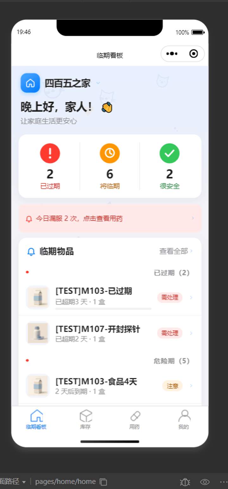
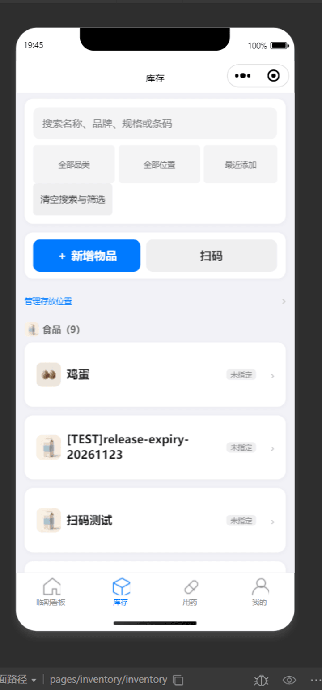
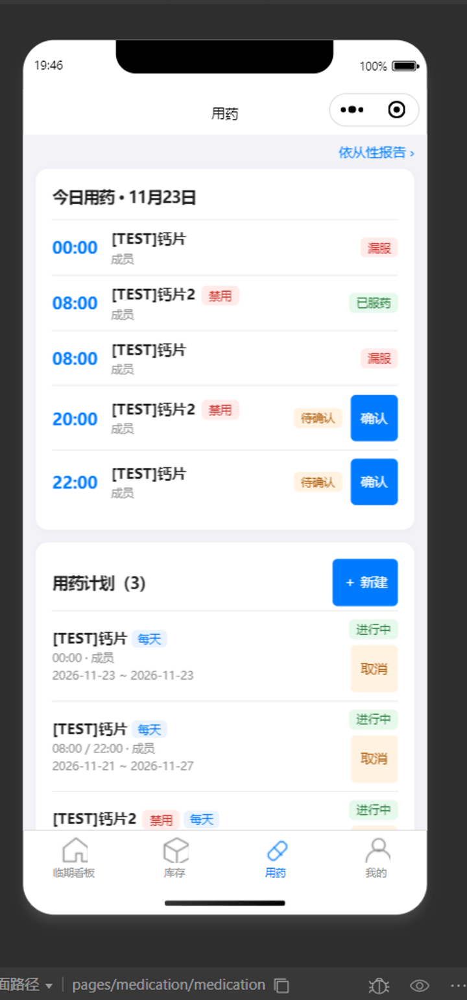
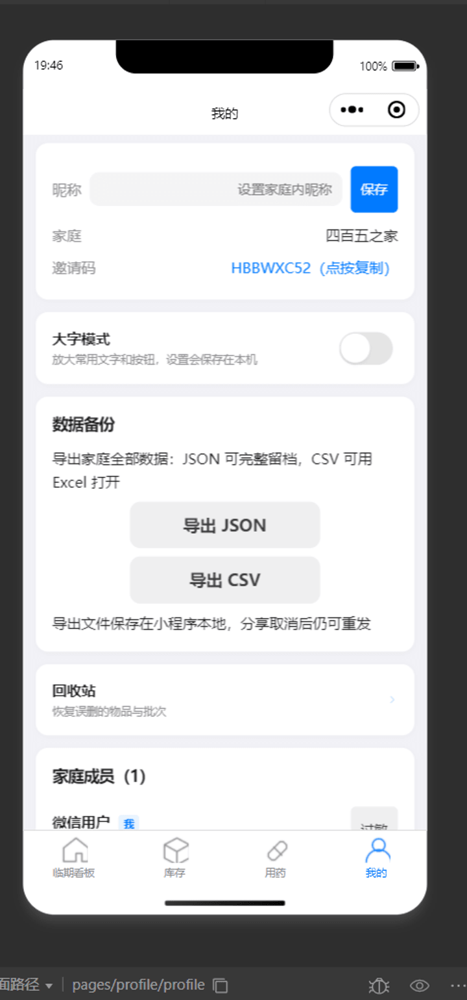
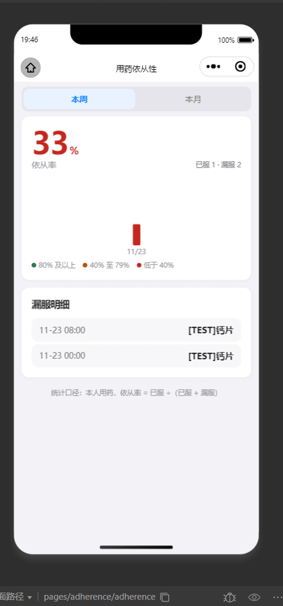
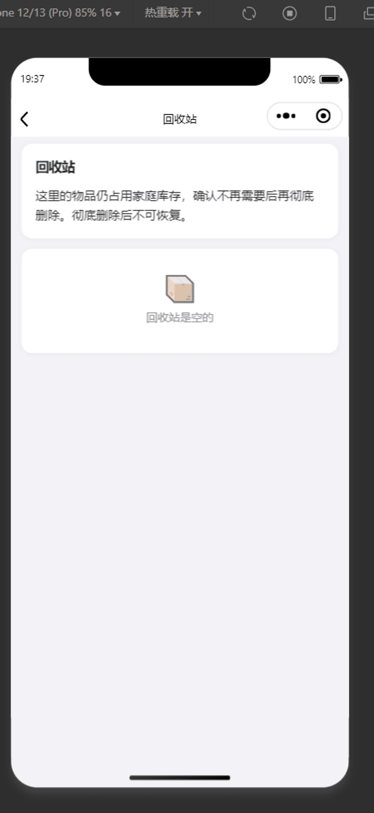
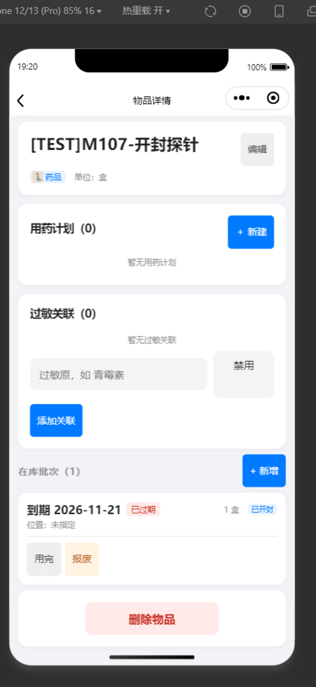

# 小咪工具箱

家庭物品**保质期 + 用药管理**微信小程序（界面名「小咪工具箱」，注册名「家庭保质期」）。

家庭成员共享一份库存；临期按红/橙/绿三分级提醒；药品支持过敏档案、冲突标红、用药计划、打卡与漏服红标；V2 增扫码录入、存放位置、操作流水与拍照识别。

V3.0 的四个 Tab 聚焦今日任务、库存、用药和家庭设置。V3 写入依赖 `sql/08` 至 `sql/11`。测试环境完成迁移和登录回归后再切换客户端。 [工程交接](docs/briefs/v3-engineering.md) · [验收记录](docs/briefs/v3-delivery.md)

## 功能

> 📷 真机截图待补：看板 / 库存 / 详情 / 用药 / 我的（5 张）

| 模块 | 内容 |
|---|---|
| 库存与保质期 | 录入（直接填到期日，或生产日期 + 保质期天数换算）、看板三分区（已过期 / 危险期 / 警告期）、品类分组、批次增删改、开封 / 用完 / 报废 |
| 家庭协作 | 邀请码加入、成员管理、一人一家庭门禁 |
| 用药管理 | 过敏档案、药品过敏关联、冲突标红（禁用红 / 慎用橙）、用药计划（每日 / 隔日，疗程 ≤180 天）、整疗程 doses 一次性生成、打卡、cron 漏服翻转 |
| V2 增强 | 存放位置、扫码录入（命中 / 未命中 / 取消三分支）、操作流水（create / open / use_up / discard）、拍照识别录入 |
| 易用性 | Apple iOS 风格设计系统、大字模式（本机持久化）、库存搜索 / 品类 + 位置筛选 / 三种排序、剩余保质期进度条 |
| 提醒与报告 | 低库存提醒（用光即提示 + 首页待补货入口）、用药依从性周 / 月报告（依从率 + 每日柱状图 + 漏服明细）、操作记录**本月概览**（四类动作计数 + 消耗率 + 报废统计）、数据导出（JSON 全量备份 / CSV 表格，微信文件分享）、**回收站**（软删除可恢复，彻底删除需二次确认） |

## 技术栈

- 微信小程序原生（WXML / WXSS / JS），无框架
- 云端：WorkBuddy Cloud Service（PostgreSQL，行级权限 RLS 隔离家庭数据）
- 定时任务：`pg_cron` 每 5 分钟把超阈值的 `pending` doses 翻为 `missed`
- 视觉识别：`glm-5.3-flash` 多模态模型

## 目录结构

```
pages/         home 看板 · inventory 库存 · item 详情 · item-form 录入
               scan 扫码 · profile 我的 · locations 位置 · records 流水
               medication 用药 · plan-form 计划 · allergy 过敏档案
components/    login-panel 登录面板 · batch-form 批次表单
utils/         cloud 凭证 · data-access 表访问与字段白名单 · constants 品类图标
               date 日期换算与分级 · plan-doses 疗程生成 · allergy 冲突匹配 · vision 拍照识别
sql/           00 扩展 · 01 RPC · 02 基础 schema · 03 用药模块 · 04 cron（全部幂等可重跑）
docs/          data-contract 数据契约 · test-plan 测试计划 · evidence 验收证据 · briefs 开发简报
```

## 本地运行

1. 微信开发者工具导入项目根目录
2. 终端执行 `npm install`，再点开发者工具「工具 → 构建 npm」
3. 修改 `utils/cloud.js` 中的 `publicConfig`，填入你自己的云端 `publishableKey` 与 `workbuddyOAuthClientId`

> 本仓库中的 `publishableKey` 属可公开凭证（小程序前端本就会将其打包，抓包可见），数据安全由云端 RLS 行级权限保证，不依赖该字符串保密。

## 验证

```bash
npm test
node scripts/verify-v3-postgres.mjs /absolute/path/to/@electric-sql/pglite
```

## 设计系统

- 色板：iOS systemBlue `#007AFF` · 背景 `#F2F2F7` · 三级文字灰（`#1C1C1E / #6C6C70 / #8E8E93`）
- 圆角 10 / 20 / 24rpx；触控目标 ≥ 88rpx；卡片阴影 `0 2rpx 12rpx rgba(0,0,0,.04)`
- 图标：自建 30 个 24×24 线性 SVG（stroke 1.8、圆头）；品类插画：5 张轻拟物 SVG + **5 张 3D 轻拟物 PNG（v2，256px，共 ~104KB，SVG 保留可回退）**
- 大字模式：仅调整字号 / 行高 / 触控尺寸，`storage` 持久化，不写入业务表

## 数据模型

- 基础 6 表：`households` `members` `items` `batches` `locations` `records`
- 用药 4 表：`allergies` `drug_allergy_links` `medication_plans` `medication_doses`
- 业务函数 5 个：`my_household_ids`（RLS 依赖）、`join_household` / `create_household` / `leave_household` / `remove_member`（SECURITY DEFINER，一人一家庭）
- 字段与常量语义以 [`docs/data-contract.md`](docs/data-contract.md) 为唯一权威

## 开发约定

几条踩过坑才立下的规则，改动前值得先看：

1. `utils/data-access.js` 的 `*_FIELDS` 白名单必须包含全部读写字段——漏字段会静默返回 `INVALID_PAYLOAD`
2. 修改 `utils/` 后必须「清缓存 → 全部清除 → 重新编译」，热重载不刷新工具层模块
3. WXML 事件绑定名一律小写，驼峰名会被编译层小写化导致找不到处理函数
4. 任何结构 / 函数 / RLS 变更都要落 `sql/*.sql` 留档，保持幂等可重跑
5. 三色语义固定不可翻转（红 = 过期/危险，橙 = 临期注意，绿 = 安全/在库）
6. 位置删除采用「直接删位置 + 批次悬空 `location_id` + 显示层兜底『未指定』」——SDK 会丢弃 `null`，不可用置空批次策略

## 文档

| 文档 | 说明 |
|---|---|
| [`docs/PROJECT-BRIEF.md`](docs/PROJECT-BRIEF.md) | 交接手册：环境、模型、铁律、待办（新会话先读） |
| [`docs/data-contract.md`](docs/data-contract.md) | 字段 / 枚举 / 常量 / RPC / RLS 语义，唯一权威（当前 v1.8） |
| [`docs/test-plan.md`](docs/test-plan.md) | 测试计划与执行记录（v3.0） |
| [`docs/evidence/`](docs/evidence/) | 每次验收的数据库终态证据链 |
| [`docs/research-2026-11-23.md`](docs/research-2026-11-23.md) | 同类产品调研与优化建议 |

## 界面预览

> 截图时间 2026-11-23，模拟器渲染；更多说明见 [`docs/screenshots/README.md`](docs/screenshots/README.md)

| 临期看板 | 库存 | 用药 | 我的 |
|---|---|---|---|
|  |  |  |  |

| 用药依从性报告 | 回收站 | 物品详情 |
|---|---|---|
|  |  |  |

## 路线

- V3 候选：成员昵称（流水操作人可读）、回收站（软删除）、小票 OCR 批量入库、日历视图、月度浪费统计、购物清单
- 已交付（2026-11-23）：低库存提醒、用药依从性报告、数据导出（JSON/CSV）
- 详见 [`docs/research-2026-11-23.md`](docs/research-2026-11-23.md)
