# 小咪工具箱 · 全页面截图检查报告

> 日期：2026-11-25  
> 环境：微信开发者工具 Nightly 2.02.261232（Windows）· 模拟器 iPhone 12/13  
> 项目：`D:\Code\Project\mi-toolbox`（`main @ 11d4abd` + 未提交改动）  
> 截图：14 张，统一 466×916 PNG，存于本目录  
> 数据性质：模拟器中的 `[TEST]` 前缀测试数据与"微信用户"测试账号；**未使用真实家庭数据**

---

## 0. 检查方法与限制（先说明，避免误读）

### 截图怎么来的

| 环节 | 方式 |
|---|---|
| 导航 | 调试器 Console 执行 `wx.reLaunch` / `wx.navigateTo`（纯页面路由，无业务写操作） |
| 截图 | agent-desktop 窗口截图 + 按模拟器坐标裁剪（1026,164,466×916） |
| 逐页校验 | 裁剪后目视核对标题与关键内容，排除白屏/加载中 |

### 工具链限制（已排除，不影响结论）

- `wechatide` CLI 的 simulator/automation 域全部返回 `APPID_ERROR`，无法用官方自动化接口；`open_project_window` / `close_project_window` 可用。
- 模拟器**内容区不接受程序化鼠标点击**（原生控件如 tabBar 可点），因此采用 Console 路由导航；这也是本报告"截图异常"里单独列出的环境问题，不是小程序缺陷。

### 唯一的环境写操作

截登录页时执行了 `getApp().resetSession(); wx.clearStorageSync()`，清空模拟器本地缓存以呈现未登录态。**模拟器登录态因此被清除**，如需继续调试需重新登录（点"微信一键登录"或扫码）。除此之外未执行任何写操作：未打卡、未改计划、未删除/恢复数据、未导出。

---

## 1. 核心看板

### 1.1 临期看板（首页）

| 项 | 内容 |
|---|---|
| 页面名称 | 临期看板 |
| 访问路径 | `/pages/home/home`（tabBar 第 1 项） |
| 截图 | 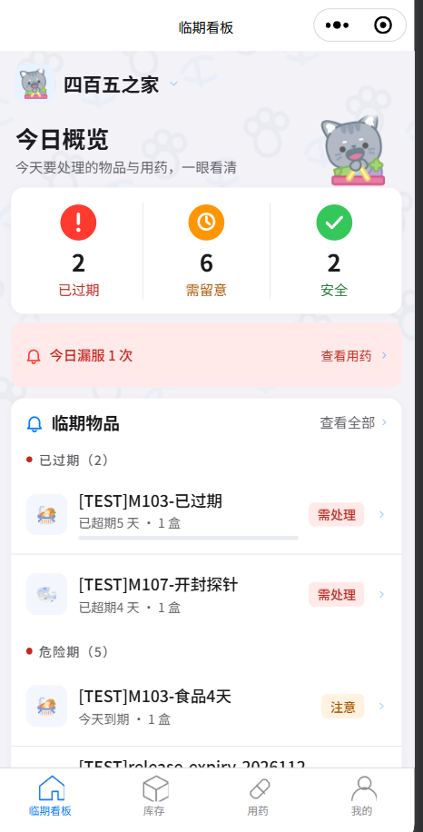 |

**功能说明**：登录/建家/入家入口；今日概览三色统计（已过期/需留意/安全）；今日漏服红条；临期物品按过期与危险期分组，行内展示插画、剩余天数、数量、状态 chip；今日用药时间线；连续打卡；待补货提醒；扫码/添加/计划/位置四个快捷入口。小咪 IP 与爪印背景位于顶部品牌区。

**截图状态**：正常。统计 2/6/2、漏服 1 次红条、临期分组与 `[TEST]` 数据行完整；未发现空白或报错。

---

## 2. 库存管理

### 2.1 库存

| 项 | 内容 |
|---|---|
| 页面名称 | 库存 |
| 访问路径 | `/pages/inventory/inventory`（tabBar 第 2 项） |
| 截图 | 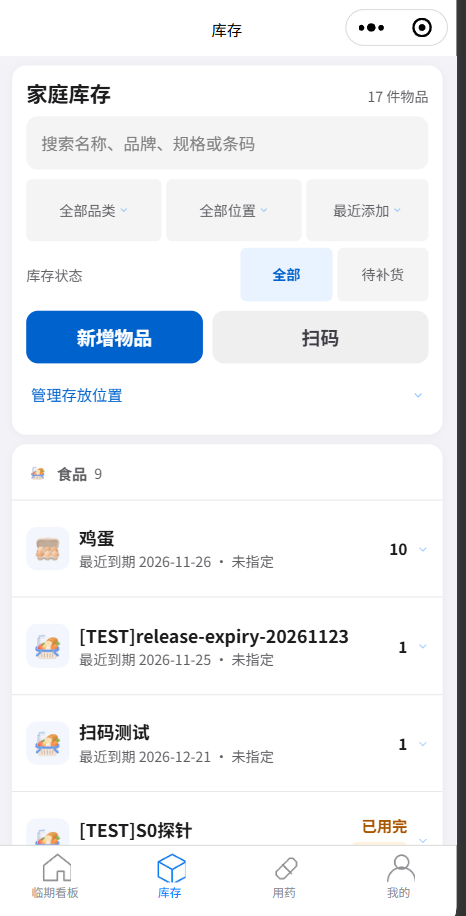 |

**功能说明**：搜索（名称/品牌/规格/条码）；品类、位置、排序三个筛选；库存状态"全部/待补货"筛选（低库存闭环）；新增物品与扫码按钮；管理存放位置入口；按品类分组的物品列表（插画、最近到期、位置、库存数、低库存标签）。

**截图状态**：正常。17 件物品、食品分组、`[TEST]` 数据行、v3 插画均正常渲染。

> **发现的异常（本次过程记录）**：切换页面时曾出现一次"还没有加入家庭"空态（同一时刻首页数据正常），重新切换后恢复。判断为 `members` 查询偶发失败/会话刷新窗口，属**待真机复现确认**的 P2 观察项，非稳定复现缺陷。

### 2.2 物品详情

| 项 | 内容 |
|---|---|
| 页面名称 | 物品详情 |
| 访问路径 | `/pages/item/item?id={itemId}` |
| 截图 | 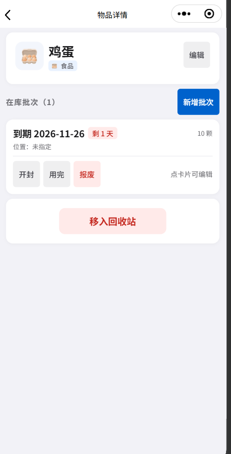 |

**功能说明**：物品信息与编辑；药品类目下展示用药计划与过敏关联；在库批次卡（到期日、状态标签、数量、位置、开封/用完/报废）；点卡片进入编辑/移入回收站；历史批次折叠；底部"移入回收站"。

**截图状态**：正常。鸡蛋物品、1 条在库批次（2026-11-26 剩 1 天）、"报废"按钮已呈红色危险样式（本轮 UI 改动生效）、"移入回收站"独立卡片层级正确。

### 2.3 录入物品

| 项 | 内容 |
|---|---|
| 页面名称 | 录入物品 |
| 访问路径 | `/pages/item-form/item-form` |
| 截图 | 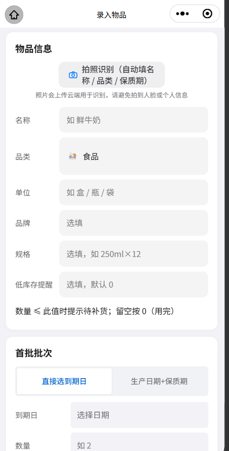 |

**功能说明**：拍照识别（自动填名称/品类/保质期，含"照片会上传云端"隐私提示）；名称/品类/单位/品牌/规格/低库存阈值；首批批次表单（直接选到期日或生产日期+保质期换算）；保存。

**截图状态**：正常。表单字段、隐私提示、批次模式切换完整；无键盘遮挡（截图态未聚焦输入框）。

### 2.4 扫码录入

| 项 | 内容 |
|---|---|
| 页面名称 | 扫码录入 |
| 访问路径 | `/pages/scan/scan` |
| 截图 | 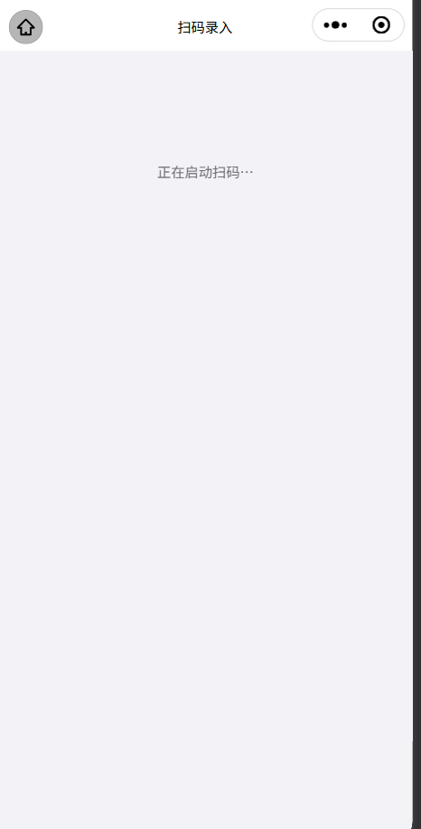 |

**功能说明**：进入即调起 `wx.scanCode`；命中条码跳物品详情，未命中带条码进录入页；失败/无家庭态提供重扫与返回。

**截图状态**：**异常**。页面停留"正在启动扫码…"，等待 12 秒未出现成功/失败回调。原因：开发者工具模拟器不支持摄像头扫码（`wx.scanCode` 无回调），属**已知环境限制**；真机行为需真机验证。页面本身无报错、无崩溃。

### 2.5 存放位置

| 项 | 内容 |
|---|---|
| 页面名称 | 存放位置 |
| 访问路径 | `/pages/locations/locations` |
| 截图 | 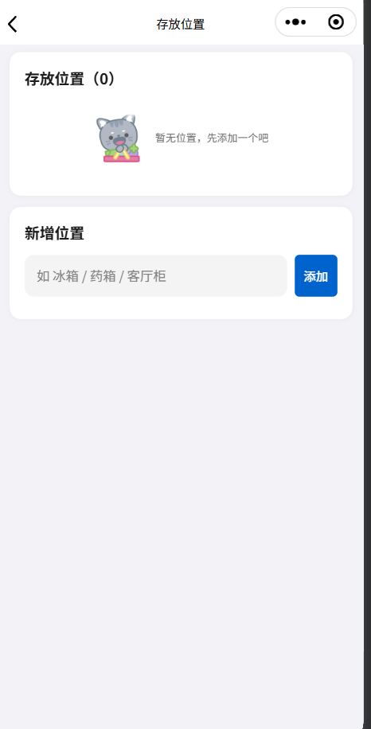 |

**功能说明**：位置列表（改名/删除）、新增位置、空态插画。

**截图状态**：正常。当前测试数据下为 0 个位置，空态文案与小咪插画正常显示。

---

## 3. 用药管理

### 3.1 用药

| 项 | 内容 |
|---|---|
| 页面名称 | 用药 |
| 访问路径 | `/pages/medication/medication`（tabBar 第 3 项） |
| 截图 | 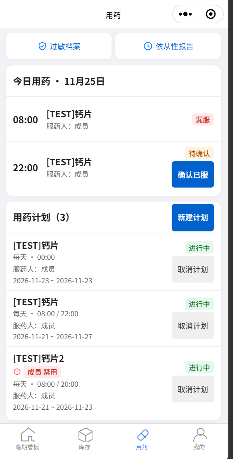 |

**功能说明**：过敏档案/依从性报告入口；今日用药时间线（时间、药名、服药人、冲突标签、状态、确认已服/更正）；用药计划列表（频次、时间点、疗程、服药人、状态、取消计划）。

**截图状态**：正常。今日 2 条（待确认/已打卡）、计划 3 条；其中"【TEST】药片 2"显示**"慎用"橙色冲突标**——过敏档案命中判定在按服药人维度工作（本轮 P0-1 修复的运行时证据）。无报错。

### 3.2 用药计划

| 项 | 内容 |
|---|---|
| 页面名称 | 用药计划 |
| 访问路径 | `/pages/plan-form/plan-form` |
| 截图 | 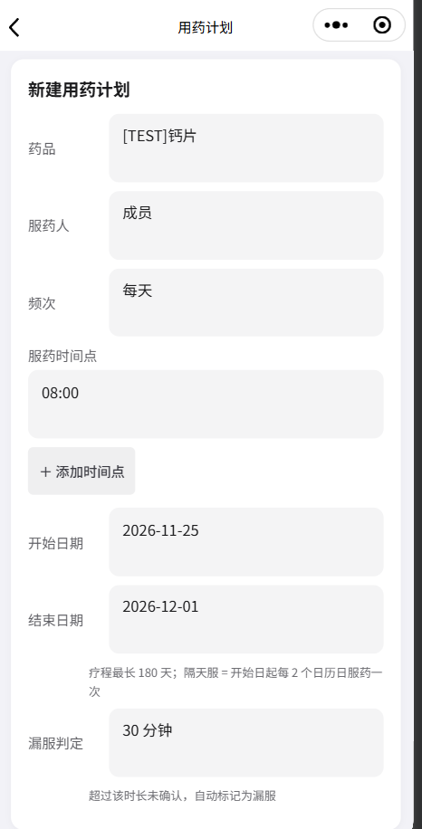 |

**功能说明**：新建/编辑计划；药品、服药人、频次、多服药时间点、起止日期、漏服判定阈值；过敏冲突横幅；保存。

**截图状态**：正常，但**首次加载偏慢**：进入 5 秒时仍显示"加载中…"，9 秒后表单完整（依赖 members + medicines 两个查询）。属 P2 性能观察项，需真机确认是否同样慢。

### 3.3 用药依从性

| 项 | 内容 |
|---|---|
| 页面名称 | 用药依从性 |
| 访问路径 | `/pages/adherence/adherence` |
| 截图 | 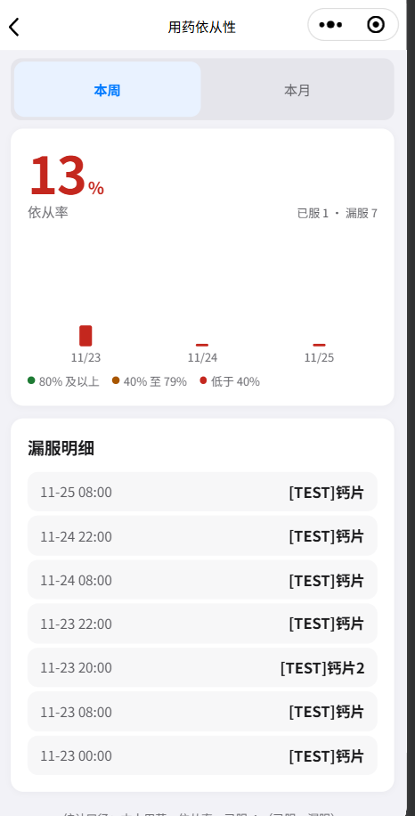 |

**功能说明**：本周/本月切换；依从率数字；逐日柱状图与图例（80%+/40-79%/<40%）；漏服明细列表；统计口径说明。

**截图状态**：正常。依从率 13%、已服 1/漏服 7、7 条漏服明细与 `[TEST]` 药品名匹配。

### 3.4 过敏档案

| 项 | 内容 |
|---|---|
| 页面名称 | 过敏档案 |
| 访问路径 | `/pages/allergy/allergy` |
| 截图 | 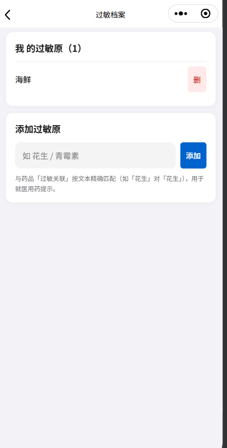 |

**功能说明**：指定成员的过敏原列表、添加/删除；仅本人或管理员可管理；精确文本匹配说明。

**截图状态**：正常。当前"我的过敏原(1)：海鲜"，添加输入框与说明完整。

---

## 4. 个人与数据

### 4.1 我的

| 项 | 内容 |
|---|---|
| 页面名称 | 我的 |
| 访问路径 | `/pages/profile/profile`（tabBar 第 4 项） |
| 截图 | 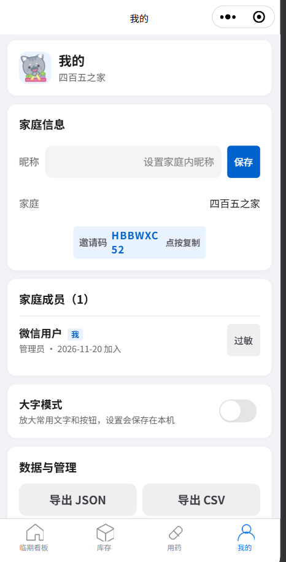 |

**功能说明**：头像与家庭名；昵称设置；邀请码复制；家庭成员（过敏入口/移除/退出）；大字模式；数据导出（JSON/CSV）；回收站与操作记录入口；退出登录。

**截图状态**：正常。家庭"四百五之家"、邀请码 `HB8WXC`、成员 1 人、大字模式开关、导出按钮均正常。

### 4.2 操作记录

| 项 | 内容 |
|---|---|
| 页面名称 | 操作记录 |
| 访问路径 | `/pages/records/records` |
| 截图 | 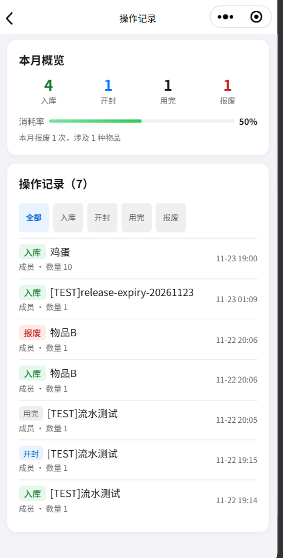 |

**功能说明**：本月概览（入库/开封/用完/报废计数）；消耗率进度条；动作筛选 chips；流水列表（动作标签、物品、数量、操作人、时间）。

**截图状态**：正常。本月 4/1/1/1、消耗率 50%、7 条记录完整；动作筛选 chips 布局正常（本轮已补按压态与 32pt 触控高度）。

### 4.3 回收站

| 项 | 内容 |
|---|---|
| 页面名称 | 回收站 |
| 访问路径 | `/pages/trash/trash` |
| 截图 | 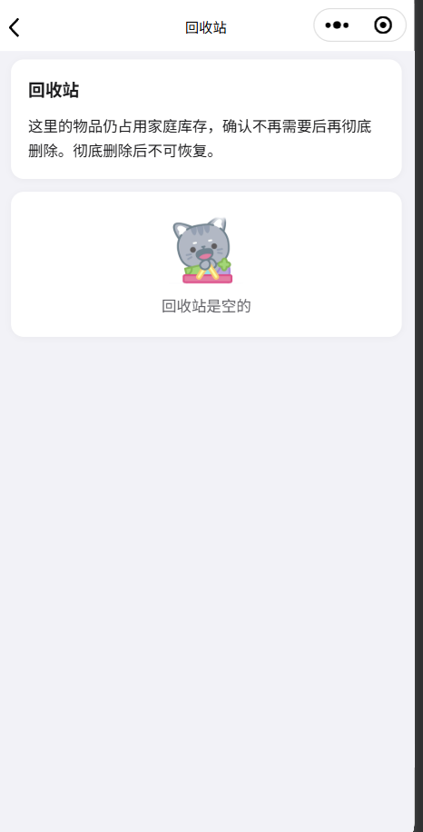 |

**功能说明**：软删物品/批次列表（恢复/彻底删除，二次确认）；空态说明"彻底删除后不可恢复"。

**截图状态**：正常。当前回收站为空，空态文案与小咪插画渲染正常。

---

## 5. 访问入口

### 5.1 登录界面

| 项 | 内容 |
|---|---|
| 页面名称 | 登录界面（未登录态） |
| 访问路径 | `/pages/home/home`（`authState = signed-out` 时渲染） |
| 截图 | 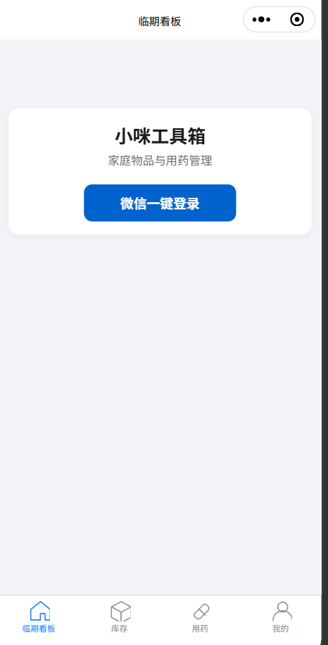 |

**功能说明**：品牌名"小咪工具箱"、副标题、微信一键登录按钮；登录后进入家庭流程。

**截图状态**：正常。品牌卡居中、主按钮蓝色实心、tabBar 未登录仍可见。本图通过清空本地缓存 + 重置会话获得，**模拟器登录态已清除**。

---

## 6. 异常与观察汇总

| # | 页面/环节 | 现象 | 等级 | 性质与建议 |
|---|---|---|---|---|
| 1 | 扫码录入 | 停留"正在启动扫码…"，12 秒无回调 | P1（功能不可用） | **模拟器限制**（无摄像头），非代码缺陷；需真机验证扫码三分支 |
| 2 | 库存 | 偶发"还没有加入家庭"空态，重切恢复 | P2（观察项） | 疑似 `members` 查询失败/会话刷新窗口；建议真机复现，必要时加自动重试 |
| 3 | 用药计划 | 首次进入 5 秒时仍"加载中"，9 秒完整 | P2（性能） | 冷启动依赖两查询；真机确认后可考虑并行加载或骨架屏 |
| 4 | 全局 Console | 4 条警告：域名校验/TLS（开发环境）、基础库 3.18.0 灰度、`LazyCodeLoading: false` | P3（提示） | 无 error；域名/TLS 警告仅开发工具校验提示，上线前在后台配置合法域名 |
| 5 | 截图工具链 | 模拟器内容区拒绝程序化点击，仅原生控件可点 | 环境问题 | 已改用 Console 路由导航；不影响小程序本身 |
| 6 | 数据 | 全部为 `[TEST]` 前缀测试数据 | 说明项 | 测试数据可用于截图演示，但不代表真实家庭数据形态 |

**未发现**：白屏页面（0/14）、JS 报错弹窗（0/14）、布局溢出/遮挡（14 张均无）、图片资源加载失败（0/14）。

---

## 7. 页面覆盖清单（核对用）

| # | 页面 | 路由 | 截图 | 状态 |
|---:|---|---|---|---|
| 1 | 临期看板 | `/pages/home/home` | `01-home.png` | 正常 |
| 2 | 库存 | `/pages/inventory/inventory` | `02-inventory.png` | 正常 |
| 3 | 用药 | `/pages/medication/medication` | `03-medication.png` | 正常 |
| 4 | 我的 | `/pages/profile/profile` | `04-profile.png` | 正常 |
| 5 | 用药依从性 | `/pages/adherence/adherence` | `05-adherence.png` | 正常 |
| 6 | 录入物品 | `/pages/item-form/item-form` | `06-item-form.png` | 正常 |
| 7 | 物品详情 | `/pages/item/item?id={id}` | `07-item.png` | 正常 |
| 8 | 扫码录入 | `/pages/scan/scan` | `08-scan.png` | 异常（模拟器限制） |
| 9 | 用药计划 | `/pages/plan-form/plan-form` | `09-plan-form.png` | 正常（首次加载慢） |
| 10 | 过敏档案 | `/pages/allergy/allergy` | `10-allergy.png` | 正常 |
| 11 | 存放位置 | `/pages/locations/locations` | `11-locations.png` | 正常（空态） |
| 12 | 操作记录 | `/pages/records/records` | `12-records.png` | 正常 |
| 13 | 回收站 | `/pages/trash/trash` | `13-trash.png` | 正常（空态） |
| 14 | 登录界面 | `/pages/home/home`（未登录） | `14-login.png` | 正常 |

覆盖：13 个注册页面 + 1 个未登录态，共 14 张，**无缺页**。

---

## 8. 截图后状态说明

- 模拟器当前处于**未登录态**（登录页），本地缓存已清空。
- 项目工作区未因截图产生业务代码改动；`project.private.config.json` 中的编译模式被改为 `auto-shot`（启动页 item-form），属本地开发配置，不影响小程序功能。
- 若需恢复模拟器登录：在登录页点"微信一键登录"，或按原流程扫码登录。
